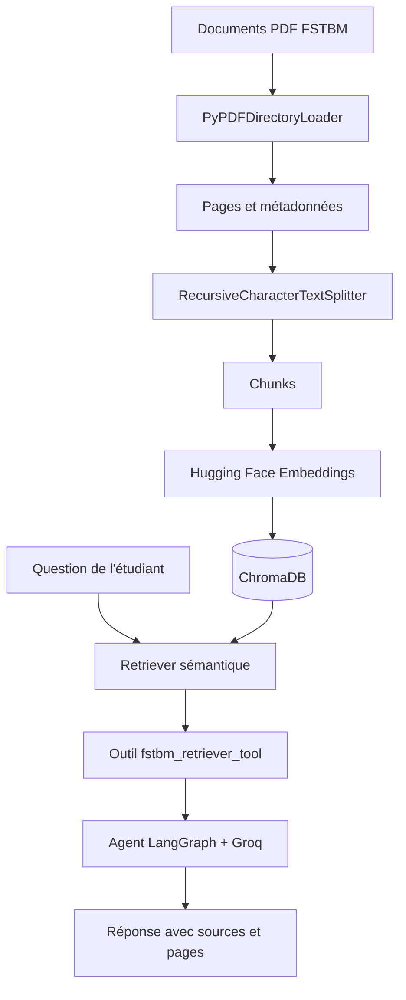
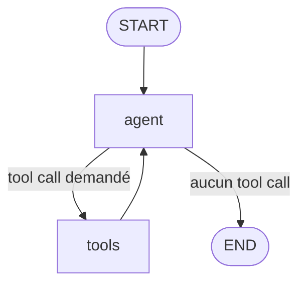

<p align="center">
  
  
  
  
  
  
  
  
  
  
</p>

---

# TP6 — RAG Agentique avec LangGraph et Groq

## Cas d'étude : assistant documentaire de la FST de Béni Mellal

Ce TP consiste à construire un assistant qui répond aux questions des étudiants de la Faculté des Sciences et Techniques de Béni Mellal. Pour répondre, l'agent recherche d'abord les informations pertinentes dans un ensemble de documents PDF, puis utilise un modèle de langage pour formuler une réponse accompagnée de ses sources.

Le projet met en œuvre un pipeline **RAG (Retrieval-Augmented Generation)** associé à un agent orchestré avec **LangGraph**. Le modèle de génération est appelé via **Groq API**.

> **Périmètre documentaire :** les réponses sont limitées aux trois documents 2026-2027 fournis pour ce TP. L'agent doit signaler une information absente ou une contradiction documentaire au lieu de l'inventer.

---

## Objectifs du TP

- Charger et vérifier des documents PDF contenant du texte extractible.
- Découper les documents en segments (*chunks*) pour faciliter la recherche.
- Transformer les segments en vecteurs (*embeddings*) avec un modèle multilingue exécuté localement.
- Stocker les vecteurs dans ChromaDB et effectuer une recherche sémantique.
- Transformer le retriever en outil utilisable par un agent.
- Construire un graphe LangGraph avec un nœud Agent et un nœud Tools.
- Utiliser Groq pour décider de l'appel de l'outil et générer la réponse finale.
- Fournir les références des documents et des pages utilisées.
- Limiter l'agent à un seul appel documentaire par question afin d'éviter les boucles infinies.

## Documents utilisés

Les trois PDF sont placés dans le dossier `resources/` et sont chargés directement par le notebook. Ils ne sont pas générés par le code.

| Fichier | Contenu exploité | Nombre de pages |
|---|---|---:|
| `Calendrier Universitaire DEUST Session de Automne 2026-2027.pdf` | Calendrier des cours, contrôles, rattrapages, jours fériés et vacances d'automne pour DEUST S1 et S3 | 1 |
| `FlayerFSTBM26-27.pdf` | Présentation de la nouvelle Licence en Sciences et Techniques, huit troncs communs et calendrier des préinscriptions | 2 |
| `MSTAIDC26-27.pdf` | Appel à candidature au Master Artificial Intelligence & Digital Computing : diplômes acceptés, critères, sélection et dossier | 2 |

Les trois fichiers comportent une couche de texte exploitable. Le notebook vérifie l'extraction avec `PdfReader` avant le chargement. **Aucun OCR n'est nécessaire pour ces PDF.**

### Arborescence attendue

```text
TP6_RAG_FSTBM/
│
├── resources/
│   ├── Calendrier Universitaire DEUST Session de Automne 2026-2027.pdf
│   ├── FlayerFSTBM26-27.pdf
│   └── MSTAIDC26-27.pdf
│
├── TP6_RAG_Agentique_FSTBM_Groq.ipynb
├── .env
├── .gitignore
├── pyproject.toml
└── uv.lock
```

Le notebook attend précisément les trois noms de fichiers indiqués ci-dessus. Il affiche une erreur explicite si un fichier manque.

---

## Architecture générale du pipeline RAG

Le RAG combine deux étapes principales :

1. **Retrieval (recherche) :** trouver dans les documents les passages les plus proches de la question de l'étudiant.
2. **Generation (génération) :** transmettre ces passages au modèle Groq pour qu'il rédige une réponse fondée sur les sources.



### Étapes de préparation des documents

**1. Chargement des PDF**

`PyPDFDirectoryLoader` parcourt le dossier `resources/`. Chaque page PDF est chargée comme un document LangChain avec des métadonnées telles que le nom du fichier et le numéro de page.

**2. Transcription du calendrier DEUST**

Le calendrier DEUST contient une grille dont certaines cellules fusionnées et colorées rendent l'association entre les dates et les périodes difficile à conserver avec une simple extraction textuelle. Une transcription structurée des périodes du tableau est donc ajoutée au corpus. Elle reprend les dates relues dans le PDF et conserve comme référence le calendrier DEUST, page 1.

**3. Découpage en chunks**

Le `RecursiveCharacterTextSplitter` découpe les pages en segments afin que la recherche récupère des passages ciblés plutôt que des documents entiers.

| Paramètre | Valeur | Rôle |
|---|---:|---|
| `chunk_size` | 1000 | Taille maximale approximative d'un segment |
| `chunk_overlap` | 150 | Chevauchement entre segments pour préserver le contexte |

**Résultat de l'exécution :** 5 pages PDF chargées, auxquelles s'ajoute la transcription structurée du calendrier, soit 6 documents LangChain. Le découpage a produit **10 chunks**.

**4. Embeddings et base vectorielle**

Le modèle utilisé est `sentence-transformers/paraphrase-multilingual-MiniLM-L12-v2`, via `HuggingFaceEmbeddings`. Il est exécuté localement sur CPU et produit les vecteurs représentant le contenu des chunks. Le caractère multilingue du modèle permet notamment de représenter des textes en français et en arabe.

Les vecteurs sont indexés dans **ChromaDB**, dans la collection `fstbm_information_2026_2027`.

**5. Recherche sémantique**

Le retriever utilise une recherche par similarité et récupère les **5 passages les plus proches** de la question (`k=5`). Chaque passage retourné conserve son fichier source et son numéro de page.

**6. Outil RAG**

La fonction `fstbm_retriever_tool`, définie avec le décorateur `@tool`, expose la recherche documentaire à l'agent. Elle retourne les passages récupérés avec leur provenance.

---

## Graphe LangGraph de l'agent

Le graphe est construit avec `StateGraph`. Son état `SimpleAgentState` conserve l'historique des messages grâce à `add_messages`.

Il comporte deux nœuds :

- **`agent` :** envoie la question au modèle Groq. Au premier passage, le modèle peut décider d'appeler l'outil RAG.
- **`tools` :** exécute l'outil `fstbm_retriever_tool` avec `ToolNode`, puis renvoie les résultats à l'agent.

### Diagramme du graphe



### Fonctionnement détaillé

1. L'étudiant pose une question.
2. Le nœud `agent` transmet la question à Groq avec le message système.
3. Si le modèle demande une recherche documentaire, le routage conditionnel envoie le graphe vers `tools`.
4. `ToolNode` exécute le retriever, qui interroge ChromaDB et renvoie les passages pertinents.
5. Le graphe revient au nœud `agent`.
6. Lorsque le dernier message est un `ToolMessage`, `agent_node` appelle le modèle **sans lui associer les outils**. Il doit donc rédiger la réponse finale à partir des passages reçus, sans relancer une recherche.
7. Le routage constate l'absence de nouvel appel d'outil et termine le graphe avec `END`.

Cette règle limite à **un seul appel à l'outil documentaire par question**. Elle a été ajoutée pour empêcher les boucles Agent → Tools répétitives qui provoquaient auparavant un `GraphRecursionError`.

---

## Modèle de langage et configuration Groq

Le notebook utilise `ChatGroq` avec le modèle `openai/gpt-oss-20b` :

```python
model = ChatGroq(
    model="openai/gpt-oss-20b",
    temperature=0,
    max_tokens=1000,
    api_key=GROQ_API_KEY,
)

llm_with_tools = model.bind_tools(tools)
```

L'identifiant `openai/gpt-oss-20b` est le nom du modèle choisi dans l'API Groq. Les appels de génération et de Tool Calling sont effectués via **Groq API**, et non via OpenAI API.

Les embeddings ne sont pas calculés par Groq : ils sont produits localement par le modèle Hugging Face. Cela sépare la recherche vectorielle de la génération du texte.

---

## Installation et exécution

### 1. Installer `uv` (Windows / PowerShell)

Si `uv` n'est pas déjà installé :

```powershell
powershell -ExecutionPolicy ByPass -c "irm https://astral.sh/uv/install.ps1 | iex"
uv --version
```

### 2. Créer le projet et l'environnement virtuel

Pour un nouveau projet :

```powershell
uv init --python 3.12 tp6-rag-fstbm
cd tp6-rag-fstbm
uv venv --python 3.12
```

Si tu travailles déjà dans un dépôt qui contient `pyproject.toml`, ne relance pas `uv init`. Ouvre simplement le dossier du dépôt et utilise son environnement `.venv`.

### 3. Installer les bibliothèques

```powershell
uv add langgraph langchain-core langchain-groq langchain-community langchain-text-splitters langchain-huggingface sentence-transformers chromadb pypdf python-dotenv ipykernel jupyter
```

### 4. Configurer la clé API Groq

Créer un fichier `.env` à la racine du projet :

```env
GROQ_API_KEY=ta_cle_api_groq
```

La clé peut être créée depuis le tableau de bord Groq : https://console.groq.com/keys

Ne publie jamais le fichier `.env` sur GitHub. Ajouter au `.gitignore` :

```gitignore
.env
.venv/
__pycache__/
```

### 5. Enregistrer le kernel Jupyter

```powershell
uv run python -m ipykernel install --user --name tp6-rag-fstbm --display-name "Python (TP6 RAG FSTBM)"
uv run jupyter lab
```

Dans VS Code, ouvrir le notebook et sélectionner le kernel **Python (TP6 RAG FSTBM)**. Vérifier que le dossier `resources/` se trouve dans le répertoire de travail du notebook.

### 6. Exécuter le notebook

Exécuter les cellules dans l'ordre : importations, vérification des PDF, chargement, découpage, embeddings, ChromaDB, retriever, outil, modèle Groq, graphe, puis tests.

Le premier lancement peut télécharger le modèle Hugging Face. Une connexion Internet est donc nécessaire lors de ce téléchargement. Les appels de génération nécessitent une clé Groq valide et un accès à l'API.

---

## Exemple de scénario : candidature au Master AIDC

Un étudiant souhaite candidater en première année du Master Artificial Intelligence & Digital Computing à la FST de Béni Mellal pour l'année universitaire 2026-2027. Il demande quels diplômes sont acceptés, comment se déroule la sélection et quelles pièces préparer.

La question conduit l'agent à rechercher des passages dans `MSTAIDC26-27.pdf`, puis à rédiger une réponse structurée.

### Réponse documentaire — diplômes et critères

Le document mentionne les diplômes suivants :

- **LST** en Informatique, Mathématiques, Physique, Ingénierie Mathématiques et informatique ;
- **LEF en Informatique** ;
- tout diplôme équivalent en Informatique.

Les critères indiqués comprennent les mentions, le nombre d'années d'étude, les notes des matières principales en informatique et mathématiques appliquées, ainsi que l'engagement et la disponibilité du candidat pour suivre toute la formation.

### Étapes de sélection

Le document énumère trois étapes :

1. Présélection sur étude du dossier ;
2. Épreuve écrite ;
3. Entretien oral.

Le document mentionne une épreuve écrite, mais n'en précise pas le contenu.

### Pièces du dossier de candidature

Le dossier est composé des éléments suivants :

1. Formulaire à remplir en ligne (préinscription obligatoire) ;
2. Demande manuscrite adressée à Monsieur le Doyen de la FST ;
3. Lettre de motivation ;
4. Copies certifiées du Baccalauréat et du diplôme requis (Licence ou équivalent) ;
5. Copies des relevés de notes ;
6. Copie de la carte d'identité nationale ;
7. Certificat de travail ou déclaration de non-emploi, le cas échéant.

Les candidats retenus pour l'entretien oral doivent présenter leur dossier au format papier le jour de l'entretien.

### Contradiction sur la date limite

Le PDF `MSTAIDC26-27.pdf` contient deux indications différentes :

- « Dernier délai de pré-inscription en ligne : 25 août 2026 » ;
- dans le calendrier du concours : « Pré-inscription en ligne : avant le 31 août 2026 ».

L'agent signale cette contradiction et recommande de vérifier la date exacte auprès de la FST, plutôt que de choisir arbitrairement l'une des deux dates.

**Source :** `MSTAIDC26-27.pdf`, pages 1 et 2.

---

## Tests et résultats obtenus

Le notebook exécuté contient un exemple de candidature au Master AIDC, puis trois questions de validation supplémentaires. Les trois tests de validation se sont terminés et le graphe a atteint `END` sans `GraphRecursionError`.

### Test 1 — Filières de la nouvelle Licence

**Question :** Quelles sont les huit filières de la nouvelle Licence en Sciences et Techniques proposées par la FST de Béni Mellal en 2026-2027 ?

**Réponse obtenue :**

1. Génie Biologique (GB)
2. Génie de l'Environnement et Géosciences (GEG)
3. Génie Mécanique et Systèmes Industriels (GMSI)
4. Génie Physique (GP)
5. Mathématiques et Sciences des Données (GMSD)
6. Génie Informatique (GI)
7. Génie Electrique et Systèmes Embarqués (GESE)
8. Génie Chimique (GC)

**Source :** `FlayerFSTBM26-27.pdf`, page 1. Les huit filières correspondent à la liste du flyer.

### Test 2 — Candidature au Master AIDC

**Question :** quels diplômes et critères sont indiqués, quelles sont les étapes de sélection, quelles pièces composent le dossier et quelle contradiction existe sur la date limite ?

**Résultat :** l'agent a retrouvé les trois catégories de diplômes, les critères de sélection, les trois étapes, les sept pièces du dossier et l'obligation de présenter le dossier papier le jour de l'entretien pour les candidats retenus. Il a également signalé les deux dates de préinscription présentes dans le document : 25 août 2026 et avant le 31 août 2026.

**Source :** `MSTAIDC26-27.pdf`, pages 1 et 2. Le contenu de l'épreuve écrite n'est pas précisé dans le document.

### Test 3 — Calendrier DEUST

**Question :** quelles sont toutes les périodes de contrôles, les périodes de rattrapage et les dates des vacances d'automne d'après le calendrier DEUST 2026-2027 ?

**Réponse obtenue :**

| Activité | Périodes |
|---|---|
| Contrôles DEUST S1+S3 | Du 4 au 9 janvier 2027 |
| Contrôles DEUST S1+S3 | Du 12 au 13 janvier 2027 |
| Contrôles DEUST S1+S3 | Du 15 au 16 janvier 2027 |
| Contrôles de rattrapage DEUST S1+S3 | Du 18 au 23 janvier 2027 |
| Contrôles de rattrapage DEUST S1+S3 | Du 1er au 6 février 2027 |
| Vacances d'automne | Du 24 au 31 janvier 2027 inclus |

**Source :** `Calendrier Universitaire DEUST Session de Automne 2026-2027.pdf`, page 1. Les plages ont été transcrites à partir du tableau visuel afin de conserver le lien entre les dates et les périodes.

### Bilan de l'exécution

- Les trois PDF ont été chargés et vérifiés sans OCR.
- La recherche manuelle a récupéré cinq passages pertinents pour la question sur les filières.
- Dix chunks ont été créés et indexés dans ChromaDB.
- Le modèle Groq a utilisé l'outil documentaire pour répondre aux questions.
- L'exemple Master AIDC et les trois tests ont abouti à une réponse finale.
- Les journaux montrent parfois une réponse HTTP `429 Too Many Requests` suivie d'une nouvelle tentative réussie (`200 OK`).
- Les trois tests de validation se terminent sans erreur de récursion.

---

## Technologies utilisées

| Technologie / bibliothèque | Rôle |
|---|---|
| Python 3.12 | Langage de programmation |
| `uv` | Gestion de l'environnement et des dépendances |
| Jupyter Notebook | Développement et exécution du TP |
| PyPDF / `PyPDFDirectoryLoader` | Lecture des pages PDF et extraction du texte |
| `RecursiveCharacterTextSplitter` | Découpage des documents en chunks |
| Hugging Face Sentence Transformers | Calcul local des embeddings multilingues |
| ChromaDB | Stockage vectoriel et recherche par similarité |
| LangChain | Documents, messages, retriever et outils |
| LangGraph | Construction et orchestration du graphe agentique |
| Groq API / `ChatGroq` | Appels au modèle de langage et Tool Calling |
| `python-dotenv` | Chargement de la clé API depuis `.env` |

## Conclusion

Ce TP a permis de réaliser un assistant documentaire spécialisé dans les informations de la FST de Béni Mellal. Les trois PDF sont chargés et transformés en chunks, représentés par des embeddings multilingues, puis indexés dans ChromaDB. Le retriever est exposé comme outil LangChain et utilisé par un agent LangGraph connecté à Groq.

L'agent peut ainsi retrouver les informations relatives aux filières de Licence, à la candidature au Master AIDC et au calendrier DEUST 2026-2027. Les réponses sont accompagnées des documents sources et de leurs pages. Le TP montre également l'intérêt d'une transcription structurée pour les tableaux PDF et d'un routage contrôlé pour éviter les appels d'outils en boucle.

---

<p align="center">
  <strong>Réalisé par : Aguelloul Mouad</strong><br>
  <strong>Encadré par : Lhoussaine Daoudi</strong>
</p>
